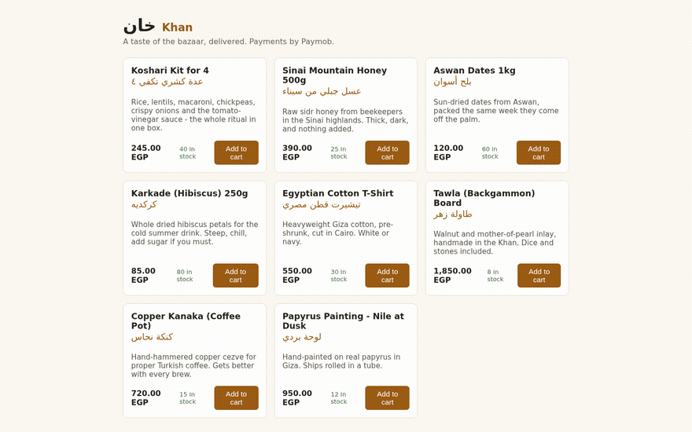
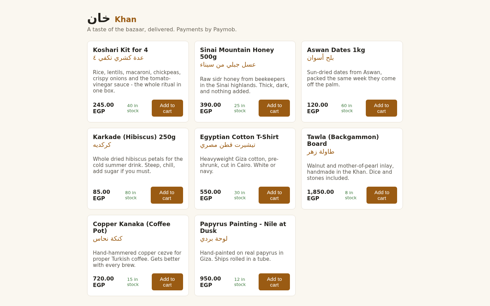
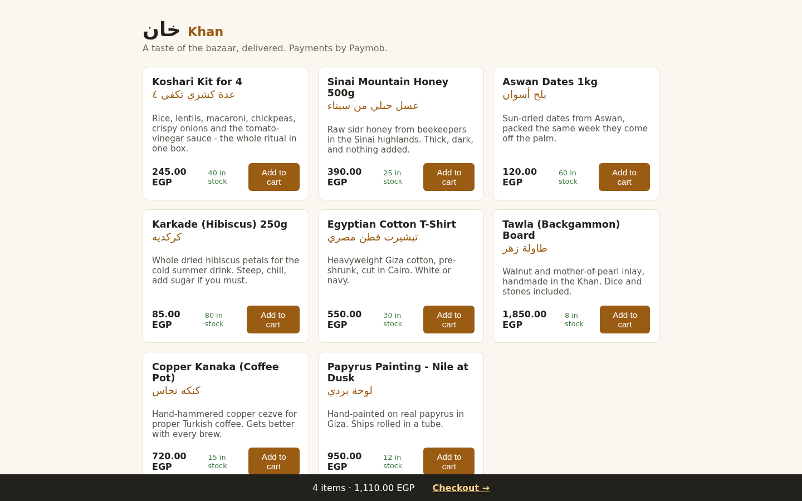
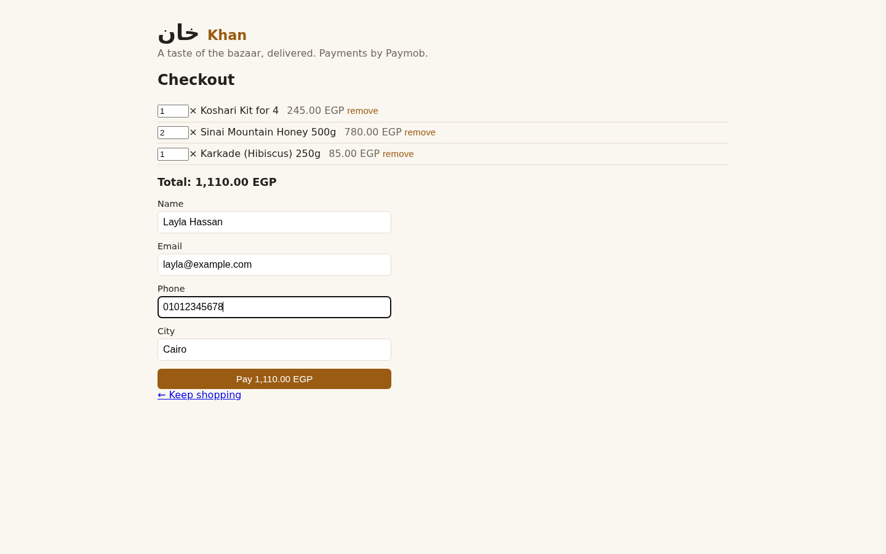
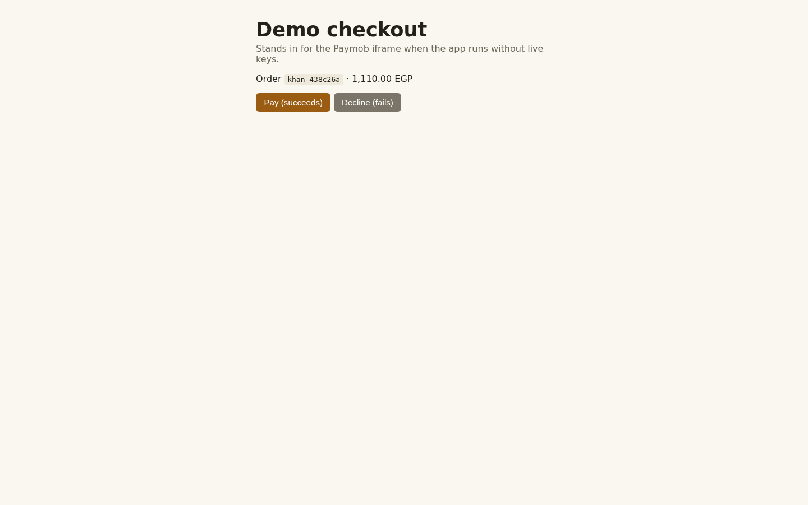
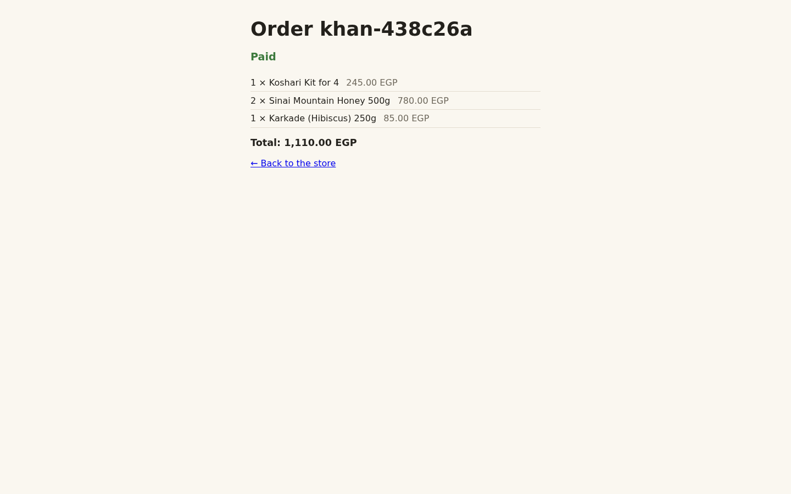

# Khan خان

[](https://github.com/SENESO/khan-store/actions/workflows/ci.yml)

A small but real Egyptian e-commerce store: ASP.NET Core 8 API, React
storefront, SQLite persistence, and **Paymob** checkout - wired through
[Paymob.Net](https://github.com/SENESO/Paymob.Net), the .NET SDK for Egypt's
leading payment gateway. This repo doubles as the SDK's reference
implementation: every payment concept (checkout session, HMAC-signed webhook,
idempotent order updates) is exercised here the way a merchant would use it.

The catalog is a Khan el-Khalili shelf: koshari kits, Sinai honey, Aswan
dates, karkade, tawla boards, copper kanakas - priced in EGP.

## What it looks like

Browse, add to cart, check out, pay - the full demo-mode flow:



| Storefront | Cart |
| --- | --- |
|  |  |
| **Checkout** | **Demo payment page** |
|  |  |
| **Paid order** | |
|  | |

## Run it

```bash
dotnet run --project src/Khan.Api
# open http://localhost:5199
```

With no Paymob keys configured the app runs in **demo mode**: checkout
redirects to a built-in stand-in payment page that signs a realistic
transaction callback and feeds it through the same webhook code production
uses - so the full flow (browse -> order -> pay -> webhook -> paid, stock
decremented) works offline with zero setup.

To accept real payments, fill in `Paymob` in configuration
(`ApiKey`, `SecretKey`, `HmacSecret`, `IntegrationId`, `IframeId`) and the
store switches to live Paymob iframe checkout. Point your Paymob dashboard's
transaction callback at `POST /api/webhooks/paymob`.

## The rules the code enforces

- **The server prices every order.** Clients send product ids and quantities
  only; totals are recomputed from the catalog, so a browser can never name
  its own price.
- **Webhooks are untrusted input until proven otherwise.** The HMAC signature
  is validated (via the SDK's `PaymobWebhookValidator`) before the payload is
  read; forged callbacks get a 401.
- **Callbacks are idempotent.** Paymob retries webhooks; a repeat delivery of
  a paid order is a no-op, and stock moves exactly once, at payment time -
  abandoned carts never hold inventory.
- **Order lines are snapshots.** Name and unit price are copied onto the
  order at purchase time; later catalog edits don't rewrite history.

## Stack and layout

```
src/Khan.Core     domain, EF Core + SQLite, checkout service, webhook processor,
                  payment gateway abstraction (Paymob via SENESO.Paymob.Net,
                  offline fake for demo mode)
src/Khan.Api      minimal-API endpoints, webhook endpoint, serves the built SPA
web/              React + Vite storefront (builds into src/Khan.Api/wwwroot)
tests/Khan.Tests  WebApplicationFactory tests: pricing, checkout validation,
                  paid/failed webhooks, HMAC rejection, idempotency, stock
```

Frontend dev loop: `npm run dev` in `web/` (proxies `/api` to the API).
Production build: `npm run build` writes into the API's wwwroot, so
`dotnet run` serves everything as one unit.

## Tests

```bash
dotnet test   # 8 tests, full stack against a throwaway SQLite file
```

## Limits (it's v1)

Single currency (EGP), no shipping zones or delivery fees, no user accounts
(guest checkout), no refund flow from the UI (the SDK supports it), and the
demo payment page is exactly that - it disappears the moment real keys are
configured.
